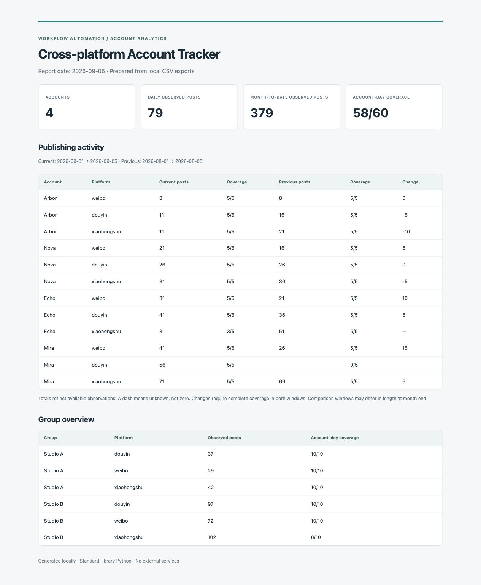

# Cross-platform Account Tracker

English · [中文](./README.zh-CN.md)

**Cross-platform account monitoring and analytics.**

Turn daily account exports into consistent publication summaries, platform comparisons, and recurring reports.

This public edition rebuilds a workflow I originally developed in Stata during a Weibo internship. It uses a dependency-free Python implementation and entirely synthetic examples. Original company files and account data are not included.

## Try it

Requires Python 3.9 or later. No packages or API keys are needed.

```bash
python3 tracker.py --input examples --date 2026-09-05 --output reports
```

Open `reports/report.html` for a visual summary, or use the CSV and JSON outputs in another workflow. Re-running overwrites generated files in the output directory.



## What it does

- Keeps a consistent account roster across platforms.
- Produces daily and month-to-date publication summaries.
- Compares the same elapsed days in the previous month.
- Produces platform rankings and group summaries with data-coverage indicators.
- Preserves missing observations separately from confirmed zero activity.

```text
Account roster + daily platform counts
                   ↓
Validate → match accounts → aggregate → compare periods
                   ↓
CSV tables + structured JSON + HTML report
```

## Data contract

Provide two UTF-8 CSV files. See [examples](./examples).

| File | Columns | Rule |
| --- | --- | --- |
| `accounts.csv` | `account_id,account_name,group` | One row per account; IDs remain strings. |
| `observations.csv` | `date,account_id,platform,posts` | One row per account/platform/day; posts must be a nonnegative integer. |

Default platforms: `weibo,douyin,xiaohongshu`. Select a subset or supply other platform names with `--platforms`, for example:

```bash
python3 tracker.py --input examples --date 2026-09-05 --platforms weibo,douyin --output reports
```

Inputs must already use a common account ID across platforms. This tool processes prepared exports; it does not scrape sites or resolve account identities.

## Reading the results

| Output | Contents |
| --- | --- |
| `daily.csv` | Selected-day counts for every monitored account and platform. |
| `monthly.csv` | Month-to-date counts, comparable prior-period counts, coverage, and change. |
| `rankings.csv` | Within-platform ranking of accounts with complete current-period coverage. |
| `groups.csv` | Group/platform observed totals and expected versus observed account-days. |
| `summary.json` | Report parameters, observed totals, coverage, and excluded input-row counts. |
| `report.html` | A local visual report; no external scripts or network requests. |

**Coverage matters.** A missing row means unknown activity; an explicit `0` means observed inactivity. Period totals sum available observations and are marked `complete`, `partial`, or `missing`. Changes are calculated only when both periods are complete. Rankings exclude incomplete accounts. Group totals remain observed totals, with coverage shown alongside them.

The comparison window starts on the first day of each month. The prior window ends on the same day number, capped at that month's last day. For example, March 31 compares with February 1–28/29; read the actual date ranges before comparing totals. Activity after the selected date does not enter current totals.

Rows outside the roster or selected platforms are excluded and counted in the summary. Duplicate account/platform/day observations are rejected rather than silently summed. Malformed dates and counts are rejected even in otherwise excluded rows.

## Design notes

The earlier Stata workflow joined account rosters, consolidated daily/monthly data, and compared platform publishing activity. This edition makes those operations portable and explicit: stable keys, configurable paths, separate zero/missing values, and reproducible fixtures. It adds coverage checks and automated tests.

Publication counts describe activity, not content quality or policy compliance. This repository demonstrates data and workflow automation; it does not contain an AI moderation agent.

## Validation

```bash
python3 -m unittest discover -s tests -v
```

Tests cover duplicate keys, zero versus missing data, incomplete coverage, out-of-scope records, date boundaries, and report totals.
